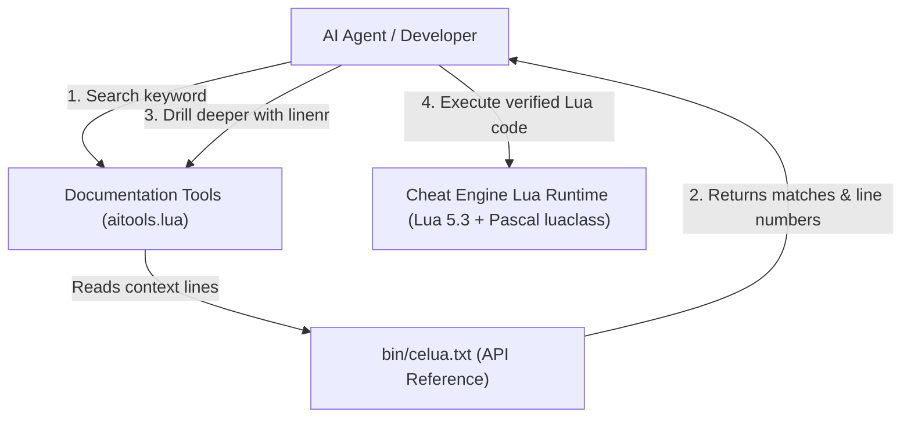

# Cheat Engine Lua Scripting Skill (`ce-lua`)

Cheat Engine embeds a customized **Lua 5.3** engine running inside the Application. Lua in Cheat Engine has direct access to target process memory, symbol tables, the Auto Assembler engine, the debugger, and GUI widgets (`TForm`, `TButton`, `TListView`, etc.).

---

## When to Use This Skill

Activate this skill when:
- Writing or debugging Cheat Engine Lua scripts, plugins, autorun extensions, or table scripts.
- Looking up Cheat Engine Lua function signatures dynamically using `getCELuaDocumentationByKeyword` and `getCELuaDocumentationByLineNumber`.
- Executing registered AI tools directly from inside Lua by calling `aitools.<toolName>.functionToCall({argName = value, ...})` with a table of argument names and values, enabling multi-step automation without round-trip latency.
- Scanning target process memory for byte patterns using `AOBScan`, `AOBScanUnique`, or `AOBScanModuleUnique`.
- Working with Cheat Engine's native Pascal class wrappers, specifically `StringList` and `Strings`.
- Managing native object lifecycles using `object.destroy()`.
- Interacting with Cheat Engine's GUI, Address List, or memory structures from background worker threads using `synchronize`.

---

## Core Architecture & Documentation Lookup

Cheat Engine ships with an authoritative, offline documentation file located at `bin/celua.txt`. Rather than guessing or assuming standard Lua library functions, AI agents should query this documentation at runtime.



### Dynamic Documentation Tools

When developing scripts or checking function parameters, use the specialized MCP / AI tools:

#### 1. `getCELuaDocumentationByKeyword`
Retrieves sections of `celua.txt` matching a given keyword (case-insensitive).
- **Parameters**:
  - `keyword` (`string`, required): Name of the function, class, property, or concept (e.g. `"AOBScan"`, `"Stringlist"`, `"readBytes"`).
  - `range` (`integer`, optional, default: 2): Number of lines before and after each match to return (default returns 5 lines per hit).
- **Return format**: A list of result blocks containing `lineNumber` and `text`.

#### 2. `getCELuaDocumentationByLineNumber`
Reads a contiguous block of documentation starting from a specific line number.
- **Parameters**:
  - `linenr` (`integer`, required): Starting line number in `celua.txt`.
  - `linecount` (`integer`, required): Number of lines to read.
- **Usage**: Once `getCELuaDocumentationByKeyword` pinpoints where a class or function is defined, use `getCELuaDocumentationByLineNumber` to read the complete class definition or multi-line function documentation.

---

## Calling AI Tools from Inside Lua (`aitools`)

Cheat Engine's AI extension registers all available AI tools into a global Lua table named `aitools` (`_G.aitools`). 

When an AI agent or LLM writes Lua code to run inside Cheat Engine (for instance, via `executeLuaCode`, the Lua Engine window, or within table scripts), it is often far more efficient to **call the registered AI tools directly from inside Lua** rather than issuing separate round-trip tool calls back and forth across the model context window.

> [!TIP]
> **Why call tools from Lua?**
> - **Zero Round-Trip Latency**: Execute an entire pipeline (e.g. scan memory -> refine results -> read data -> write memory or create cheat table records) in a single execution turn.
> - **In-Process Loops & Logic**: Loop over memory addresses, filter data, and inspect values directly inside Lua without serializing thousands of bytes over JSON-RPC.
> - **Tool Definitions**: You do not need to guess function signatures—the tool names, parameter schemas, and descriptions are already provided by your active `tools` declarations.

### Calling Convention: `aitools.<toolName>.functionToCall(argsTable)`

Every registered tool in `aitools` exposes a `functionToCall` property.

> [!IMPORTANT]
> `functionToCall` does **NOT** accept a list of positional arguments (e.g. `func(val1, val2)` or an array `{val1, val2}`).
> It strictly takes **a single table containing the argument names and their values** as key-value pairs:
> `{ argumentName1 = value1, argumentName2 = value2 }`.

```lua
-- INCORRECT: Do not pass positional arguments or an array of values:
-- aitools.readMemoryBlock.functionToCall("75288C54C360", "vtQword", 4)
-- aitools.readMemoryBlock.functionToCall({"75288C54C360", "vtQword", 4})

-- CORRECT: Pass a table containing the argument names and their values:
return aitools.readMemoryBlock.functionToCall({
  address = "75288C54C360",
  elementType = "vtQword",
  count = 4
})
```

You can also use bracket notation for dynamic tool names:
```lua
aitools["readMemoryBlock"].functionToCall({
  address = "75288C54C360",
  elementType = "vtQword",
  count = 4
})
```

### Parameter Passing & Return Values

1. **Named Arguments Table**:
   The keys in the table passed to `functionToCall` must match the parameter names specified in the tool's declaration (e.g. `address`, `elementType`, `count`, `value`, `scanoption`, etc.).

2. **Parameterless Tools**:
   For tools that require no arguments, pass an empty table `{}`:
   ```lua
   local procInfo = aitools.getOpenedProcessName.functionToCall({})
   ```

3. **Direct Return Values**:
   `functionToCall` directly returns the tool's result table (or value). When executing inside `executeLuaCode`, prepending `return` returns that result directly to the caller:
   ```lua
   local res = aitools.getTargetedProcessInfo.functionToCall({})
   if res.is64Bit then
     print("Target is 64-bit architecture")
   end
   return res
   ```

### Pipelining Multi-Step Operations in Lua

Instead of making multiple separate tool calls across separate chat turns, combine them into one Lua script:

```lua
-- Step 1: Scan for value 1000
local scan = aitools.scanMemory.functionToCall({
  value = "1000",
  vartype = "vtDword",
  scanoption = "soExactValue"
})

if not scan or not scan.scannerID then
  return { error = "Scan failed", details = scan }
end

local scanID = scan.scannerID

-- Step 2: Retrieve the top found addresses
local results = aitools.getResultsAndValues.functionToCall({
  scanID = scanID,
  startIndex = 0,
  count = 5
})

-- Step 3: Create a memory record for the first result
if results and results.results and #results.results > 0 then
  local firstAddress = results.results[1].address
  local record = aitools.createMemoryRecord.functionToCall({
    description = "Player Health",
    address = firstAddress,
    vartype = "vtDword"
  })
  return { status = "success", address = firstAddress, memoryRecordID = record.memoryRecordID }
else
  return { status = "no results found" }
end
```

---

## Native Object Lifecycle (`Object` & `.destroy()`)

Cheat Engine exposes Free Pascal classes to Lua via a custom metatable bridge (`luaclass`). 

> [!IMPORTANT]
> **No Automatic Garbage Collection**: Native Pascal objects exposed to Lua do not have automatic Lua garbage collection enabled (`__autodestroy = false`). Most functions that create or return an object (`createStringlist()`, `AOBScan()`, `createTimer()`, `createForm()`, `getInternet()`, etc.) require manual memory management.
>
> **Method Name**: In Cheat Engine Lua, `object.free()` does **not** exist. Always use `object.destroy()`.

### Ownership & Destruction Rules

1. **Standalone Objects (Caller-Owned)**:
   Objects created without a parent or returned by standalone utility functions **must** be explicitly destroyed by calling `.destroy()` when no longer needed:
   ```lua
   local sl = createStringlist()
   -- ... use sl ...
   sl.destroy() -- Required to release native Pascal memory
   ```

2. **Component Children (Owner-Managed)**:
   Controls created with an owner Component (e.g. `createPanel(form)`, `createButton(form)`) are owned by that parent. When the parent form is destroyed via `form.destroy()`, all owned child components are destroyed automatically.

3. **Global / Engine-Owned Objects (DO NOT DESTROY)**:
   Certain objects represent global Cheat Engine state. Never call `.destroy()` on:
   - `getAutoAttachList()`
   - `getCommonModuleList()`
   - Pre-existing UI collections owned by controls (e.g. `memo.Lines`, `combobox.Items`, `listitem.SubItems`)

---

## Working with `Strings` and `StringList`

Cheat Engine's `Stringlist` class inherits from `Strings`, which wraps Free Pascal's `TStrings` / `TStringList`. It is frequently returned by scanning APIs (like `AOBScan`) and accepted by system enumeration routines (like `getProcesslist(Strings)` and `getWindowlist(Strings)`).

### Differences from Standard Lua Tables

| Feature | Standard Lua Table | Cheat Engine `StringList` / `Strings` |
| :--- | :--- | :--- |
| **Creation** | `{}` | `createStringlist()` or returned by CE APIs |
| **Indexing** | 1-based (`tbl[1]`) | **0-based** (`list[0]` to `list[list.Count - 1]`) |
| **Length** | `#tbl` | `list.Count` or `#list` |
| **Access Item** | `tbl[i]` | `list[i]` or `list.getString(i)` |
| **Combined Text** | `table.concat(tbl, "\n")` | `list.Text` (or `list.getText()`) |
| **Memory Cleanup** | Handled by Lua GC | **Must call `list.destroy()`** (for caller-owned lists) |

### Common `Strings` / `StringList` Operations

```lua
local sl = createStringlist()

-- Adding items
sl.add("First entry")
sl.addText("Second entry\nThird entry")

-- 0-based iteration
for i = 0, sl.Count - 1 do
  print(string.format("Item %d: %s", i, sl[i]))
end

-- Searching and manipulating
local idx = sl.indexOf("Second entry") -- returns -1 if not found
if idx ~= -1 then
  sl.delete(idx)
end

-- File operations
sl.saveToFile(getCheatEngineDir() .. "test_output.txt")
sl.loadFromFile(getCheatEngineDir() .. "test_output.txt")

-- Cleanup
sl.destroy()
```

---

## Memory Scanning (`AOBScan` & `MemScan`)

Cheat Engine provides two primary scanning paradigms: high-level pattern scanning via `AOBScan` / `AOBScanUnique` / `AOBScanModuleUnique`, and advanced multi-pass scanning via the `MemScan` class.

### 1. `AOBScan` (Multiple Matches -> `StringList`)

```lua
AOBScan(aobstring, [protectionflags], [alignmenttype], [alignmentparam])
```
- **Returns**: A `StringList` object containing matching addresses formatted as hexadecimal strings (e.g. `"00405000"`, `"7FF612345678"`). If no matches are found, it returns `nil`.
- **Wildcards**: Spaces, `??`, or byte values > 255.
- **Handling Results**:
  1. Always check `if results ~= nil then`.
  2. Iterate from `0` to `results.Count - 1`.
  3. Convert hexadecimal address strings to integers using `getAddressSafe(results[i])` or `tonumber(results[i], 16)`.
  4. Call `results.destroy()` when finished.

```lua
local pattern = "48 89 5C 24 ?? 48 83 EC 20"
local results = AOBScan(pattern, "+W-C", 0, "")

if results ~= nil then
  print(string.format("Found %d matches:", results.Count))
  for i = 0, results.Count - 1 do
    local addr = getAddressSafe(results[i])
    print(string.format("  [%d] 0x%X", i, addr))
  end
  results.destroy() -- Clean up the StringList
else
  print("No matches found.")
end
```

### 2. `AOBScanUnique` and `AOBScanModuleUnique` (Single Match -> `integer`)

When you only need the first match or expect a unique pattern, use these functions:

```lua
AOBScanUnique(aobstring, [protectionflags], [alignmenttype], [alignmentparam])
AOBScanModuleUnique(modulename, aobstring, [protectionflags], [alignmenttype], [alignmentparam])
```
- **Returns**: An `integer` address (`ptruint`) on success, or `nil` if not found.
- **No StringList**: Because these return an integer directly, no object is created and no `.destroy()` call is needed.

```lua
local addr = AOBScanModuleUnique("Tutorial-x86_64.exe", "89 18 89 48 04")
if addr ~= nil then
  print(string.format("Unique pattern found at 0x%X", addr))
else
  print("Pattern not found in module.")
end
```

### 3. The `MemScan` Class (Multi-Pass & Typed Scanning)

For complex scanning workflows (e.g. exact values, unknown initial values, changed/unchanged values, or floating point comparisons), use the `MemScan` class:

- **Creating an Instance**:
  - `createMemScan()`: Creates a new standalone scanner instance (call `ms.destroy()` when finished).
  - `getCurrentMemscan()`: Returns the scanner currently active in Cheat Engine's main user interface.

- **Configuring & Running a Scan**:
  - `ms.firstScan(scanOption, varType, roundingType, input1, input2, startAddress, stopAddress, protectionflags, alignmentType, alignmentParam, isHex, isNotBinary, isUnicode, isCaseSensitive)`
  - `ms.nextScan(scanOption, roundingType, input1, input2, ...)`
  - `ms.waitTillDone()`: Waits until scanning and result saving have fully concluded.

- **Scan Options (`TScanOption`)**:
  - First & Next scan: `soExactValue`, `soValueBetween`, `soBiggerThan`, `soSmallerThan`.
  - First scan only: `soUnknownValue`.
  - Next scan only: `soIncreasedValue`, `soIncreasedValueBy`, `soDecreasedValue`, `soDecreasedValueBy`, `soChanged`, `soUnchanged`.

- **Variable Types (`TVariableType`)**:
  - `vtByte`, `vtWord`, `vtDword` (4 bytes), `vtQword` (8 bytes), `vtSingle` (float), `vtDouble`, `vtString`, `vtByteArray`, `vtBinary`, `vtAll`.

- **Extracting Results**:
  - In modern Cheat Engine: `ms.Results` returns a direct Lua table of found addresses (`ms.FoundCount` holds the count).
  - Using `FoundList`:
    ```lua
    local ms = createMemScan()
    ms.firstScan(soExactValue, vtDword, rtRounded, "100", "", 0, 0x7FFFFFFFFFFFFFFF,
                 "*X*W*C", fsmNotAligned, "1", false, false, false, false)
    ms.waitTillDone()

    local fl = createFoundList(ms)
    fl.initialize()
    print("Found: " .. fl.Count)
    for i = 0, math.min(fl.Count - 1, 9) do
      print(string.format("  [%d] 0x%X = %s", i, fl.getProcessAddress(i), fl.getValue(i)))
    end

    fl.destroy()
    ms.destroy()
    ```

### Protection Flags & Alignment Reference

- **`protectionflags`** (string):
  - `X`: Executable
  - `W`: Writable
  - `C`: Copy On Write
  - `+`: Must be set (e.g. `+W` = writable only)
  - `-`: Must not be set (e.g. `-C` = exclude copy-on-write)
  - `*` or `""`: Don't care (scan all protection types)
  - Examples: `"+W-C"` (writable, not copy-on-write), `"+X-W"` (read-only executable).
- **`alignmenttype`** (integer):
  - `0`: No alignment restriction (fastest full scan).
  - `1`: Address must be dividable by `alignmentparam` (e.g. `"4"`, `"8"`, `"16"`).
  - `2`: Address must end with `alignmentparam` (e.g. `"0"`, `"00"`).

---

### Thread Safety Rules

1. **Thread-Safe Operations (Direct Call)**:
   - Target memory access: `readBytes`, `writeBytes`, `readInteger`, `readQword`, `readPointer`, `writeInteger`, etc.
   - Address resolution: `getAddressSafe`, `getNameFromAddress`.
   - Pattern scanning: `AOBScan`, `AOBScanUnique`, `AOBScanModuleUnique`.
   - Console logging: `print()`.

2. **Non-Thread-Safe Operations (Must use `synchronize`)**:
   - Creating or modifying forms, panels, buttons, edits, or listviews or any GUI object.
   - Modifying the Address List / Cheat Table: `getAddressList()`, `addresslist_getMemoryRecordByDescription()`, toggling record activation (`memrec.Active = true`).
   - Modal or non-modal dialogs: `showMessage()`, `messageDialog()`.

```lua
-- Safe GUI interaction from a worker thread
synchronize(function()
  local al = getAddressList()
  local rec = al.getMemoryRecordByDescription("Player Health")
  if rec then
    rec.Active = true
  end
end)
```

---

## GUI Layout & Scripting Invariants

When creating Lua GUI components in Cheat Engine, adhere to the following invariants:

1. **Strict `beginUpdate()` / `endUpdate()` Balance**:
   GUI controls (such as `TListView`) disable visual updates upon `beginUpdate()` and only re-enable painting when the internal update count returns to 0. If an asynchronous fetch terminates prematurely or an unhandled error occurs without calling `endUpdate()`, the control remains permanently frozen, unrendered, or black across all platforms (Windows and Linux). Always guard updates with a boolean tracking flag or `pcall`:
   ```lua
   local updating = true
   listView.beginUpdate()
   local ok, err = pcall(function()
     -- populate listview
   end)
   if updating then
     listView.endUpdate()
     updating = false
   end
   ```

2. **No Hardcoded Pixel Coordinates**:
   - Do not use fixed `Left`, `Top`, `Width`, or `Height` on controls.
   - Set `AutoSize = true` on forms, panels, and groupboxes.
   - Position using `Anchors`, `BorderSpacing`, and `ChildSizing`.

3. **Splitter Controls Placement**:
   When creating an `alLeft` or `alTop` splitter (`createSplitter`), you must position it past the aligned control to prevent docking conflicts in the LCL align engine:
   ```lua
   local pnlLeft = createPanel(form)
   pnlLeft.Align = alLeft
   pnlLeft.Width = 300

   local splitter = createSplitter(form)
   splitter.Align = alLeft
   splitter.Width = 5
   splitter.Left = pnlLeft.Left + pnlLeft.Width + 10 -- Must be placed past pnlLeft!
   ```

---

## Common API Quick Reference

### Memory Read & Write
- `readByte(address)`, `readSmallInteger(address)`, `readInteger(address)`: 8-bit, 16-bit, 32-bit integers.
- `readQword(address)`: 64-bit integer.
- `readPointer(address)`: Reads 32-bit or 64-bit pointer based on target architecture.
- `readFloat(address)`, `readDouble(address)`: Floating point numbers.
- `readString(address, maxlength, [widechar])`: Null-terminated string.
- `readBytes(address, bytecount, [ReturnAsTable])`: Reads raw bytes. Returns table if `ReturnAsTable` is true.
- `writeBytes(address, table_or_bytes...)`: Writes raw bytes.
- `writeInteger(address, value)`, `writeQword(address, value)`: Writes integers.
- `writeFloat(address, value)`, `writeDouble(address, value)`: Writes floats.
- `writeString(address, text, [widechar])`: Writes string.

### Symbols & Modules
- `getAddressSafe(symbol_or_string)`: Resolves symbol, module+offset, or hex string to integer address. Returns `nil` on failure.
- `getNameFromAddress(address, [ModuleNames], [Symbols], [Sections])`: Converts integer address to module+offset or symbol string.
- `inModule(address)`: Returns `true` if address falls within any loaded module.
- `enumModules()`: Returns a table of loaded modules in target process (`{ { Name="...", Address=0x... }, ... }`).

### Auto Assembler Integration
- `autoAssemble(script, [target_id])`: Assembles and executes an Auto Assembler script. Returns boolean success and optional disable info table.
- `registerAutoAssemblerCommand(command, function(script, sender))`: Extends Auto Assembler syntax with custom Lua handlers.
