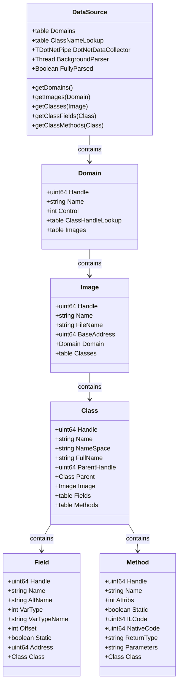

# Cheat Engine .NET Info Skill (`dotnet-info`)

The `dotnet-info` skill enables AI agents to reverse engineer, inspect, and automate targets running on the **Microsoft .NET Framework**, **.NET Core / .NET 5+**, and **Mono** runtimes via Cheat Engine's **.NET Info dialog** (`frmDotNetInfo`), the centralized **`DataSource`** caching object, and associated Lua APIs (`dotnetinfo.lua`, `DotNetInterface.lua`, and `luadotnetpipe.pas`).

---

## When to Use This Skill

Activate this skill when:
- Inspecting the class, field, and method hierarchy of .NET Framework, .NET Core / 5+, or Mono processes.
- Script-controlling or automating the Cheat Engine **.NET Info** dialog (`frmDotNetInfo`).
- Traversing, querying, or caching metadata via the unified global **`DataSource`** object.
- Scanning the managed garbage-collected heap for all live instances of a given class (`enumAllObjectsOfType` / `btnLookupInstances`).
- Reading live field values from instantiated objects or resolving static field memory addresses.
- Dynamically invoking managed methods with custom typed parameters without attaching an external debugger.
- Generating Cheat Engine Auto Assembler (AA) patch or detour templates for JIT-compiled .NET methods.
- Searching for classes, fields, or methods across all loaded assemblies (`spawnDotNetSearchDialog`).

> [!NOTE]
> For targets running purely on Unity Mono or Unity IL2CPP where deep engine-specific structures (like `GameObject`, `Transform`, `MonoBehaviour`) or Mono-specific AA directives (`USEMONO`, `FINDMONOMETHOD`, `GETMONOSTRUCT`) are needed, consider using the companion skill `monoscript`. For unified .NET metadata caching, GUI automation, and general CLR heap analysis, use `dotnet-info`.

For the exhaustive catalog of functions, types, constants, and control properties, see [references/api_reference.md](references/api_reference.md).

---

## Core Architecture & Runtimes

Cheat Engine provides a runtime-agnostic abstraction that seamlessly supports both **Microsoft .NET** and **Mono** runtimes:

```mermaid
flowchart TD
    subgraph Host["Cheat Engine Host (Lua & GUI)"]
        UI["frmDotNetInfo (GUI Dialog)"]
        DS["DataSource Cache (Global)"]
        Script["Lua Script / AI Agent"]
    end

    subgraph Target["Target Process (.NET / CLR / Mono)"]
        CLR["CLR / CoreCLR Runtime"]
        Mono["Mono Runtime"]
        InvasiveDLL["DotNetInterface.dll (Injected Active Pipe)"]
    end

    UI <-->|Display & User Actions| DS
    Script <-->|Programmatic Automation| DS
    Script <-->|Direct Control| UI

    DS -->|Passive Queries: getDotNetDataCollector()| CLR
    DS -->|Passive Queries: monopipe| Mono
    UI -.->|Active Invocation: dotnetpipe| InvasiveDLL
    Script -.->|Active Invocation: dotnet_invoke_method| InvasiveDLL
    InvasiveDLL -->|Invokes & Evaluates| CLR
```

### Runtime Modes: Mono vs. .NET

Inside `dotnetinfo.lua`, each discovered domain is tagged with a runtime control type:
- `CONTROL_MONO = 0`: Managed by the Mono runtime (Unity Mono, standalone Mono) via `monopipe`.
- `CONTROL_DOTNET = 1`: Managed by Microsoft .NET (.NET Framework 4.x, .NET Core, .NET 5/6/7/8+) via `DotNetDataCollector`.

### Passive Inspection vs. Active/Invasive Manipulation

1. **Passive Inspection (`DotNetDataCollector`)**:
   - Access via `getDotNetDataCollector()` (Pascal wrapper `TDotNetPipe`).
   - Uses CLR debugging interfaces (`ICorDebug`, `ICorProfiler`, or metadata APIs) to passively inspect AppDomains, modules, TypeDefs, method signatures, field offsets, and heap objects without running code inside the target.
   - Completely safe: does not execute managed code or disturb game execution state.

2. **Active / Invasive Manipulation (`DotNetInterface.dll`)**:
   - Launched via `LaunchDotNetInterface()`.
   - Injects `DotNetInterface.dll` into the target process and connects via named pipe `cedotnetpipe_pid<PID>`.
   - Enables executing code in the target process: invoking managed methods (`dotnet_invoke_method`), getting/setting field values dynamically (`dotnet_getFieldValue` / `dotnet_setFieldValue`), wrapping objects, and loading external assemblies (`dotnet_loadModule`).

---

## The .NET Info Dialog (`frmDotNetInfo`)

The .NET Info dialog is a multi-tabbed, virtualized inspection window for viewing the live managed architecture of the target process.

### Opening the Dialog
- **GUI Shortcut**: `Ctrl+Alt+N` or Main Menu **Mono/.Net** -> **.Net Info**.
- **Lua Command**:
  ```lua
  miDotNetInfoClick(nil)
  ```

### Window Management & Tracking
Every opened .NET Info dialog is tracked in the global table `frmDotNetInfos`:
- `getDotNetInfoList()`: Returns the table of all active `frmDotNetInfo` instances.
- Each dialog stores its bound process ID in `frmDotNetInfo.ProcessID`. If the target process changes, the dialog suspends operations to prevent mismatched memory lookups.

### GUI Layout & Component Reference

```
+-----------------------------------------------------------------------------------------+
| .NET Info - [Process: Game.exe (PID: 1234)]                                             |
+-------------------+--------------------+------------------------------------------------+
| AppDomains        | Assemblies/Images  | Class List (Filtered by: [ edtClassFilter   ]) |
| [lbDomains      ] | [lbImages        ] | [lvClasses (Virtual Owner-Data ListView)     ] |
| - DefaultDomain   | - Assembly-CSharp  |   - PlayerController                           |
|                   | - mscorlib         |   - GameManager                                |
|                   | - UnityEngine.Core |   - InventorySystem                            |
+-------------------+--------------------+------------------------------------------------+
| Class Details: PlayerController (Inherits: MonoBehaviour -> Behaviour -> Component)     |
+-----------------------------------------------------+-----------------------------------+
| Hierarchical Fields Tree [lvFields2]                | Methods [lvMethods]               |
| Offset  Name             Type             Value     | Method Signature                  |
| 0x018   m_Health         Single           100.0     | Void TakeDamage(Single amount)    |
| 0x020   m_Movement       PlayerMovement   {...}     | Void Jump()                       |
|   0x010   speed          Single           8.5       | Boolean CanMove()                 |
|   0x014   isGrounded     Boolean          True      | Single GetCurrentSpeed()          |
| 0x028   m_Stats          PlayerStats      {...}     |                                   |
+-----------------------------------------------------+-----------------------------------+
| Static Fields [lvStaticFields]                      | Instance Selector                 |
| Name             Type            Address            | Base Address: [0x1D8A2040    ] [v]|
| s_Instance       PlayerController 0x7FFDA004        | [ Lookup Instances (Heap Scan)  ] |
+-----------------------------------------------------+-----------------------------------+
```

#### 1. Domains (`lbDomains` / `gbDomains`)
- Displays all CLR Application Domains.
- If only one domain exists (standard for most games), `gbDomains` and splitter `split1` are automatically hidden and domain 0 is selected.

#### 2. Assemblies & Images (`lbImages` / `gbImages`)
- Displays all loaded PE / metadata images (assemblies) within the selected domain (e.g., `Assembly-CSharp.dll`, `mscorlib.dll`).
- Populated by `DataSource.getImages(Domain)`.

#### 3. Class List (`lvClasses` / `gbClasses`)
- Lists all TypeDefs / classes within the selected assembly.
- **Dynamic Search**: Filter in real-time by typing in `edtClassFilter`.
- **Virtual Owner-Data Mode**: Loads large assemblies with tens of thousands of classes instantly without UI lag using a background fetch thread (`ClassFetchThread`).
- **Qt6 Update Invariant**: Uses `BeginClassListUpdate` and `EndClassListUpdate` guarding `frmDotNetInfo.lvClassesUpdating` to ensure `beginUpdate()` and `endUpdate()` remain strictly balanced.

#### 4. Class Inheritance (`gbInheritance`)
- Displays the parent class hierarchy (e.g. `PlayerController` -> `MonoBehaviour` -> `Behaviour` -> `Component` -> `Object`).
- Clicking on a parent navigates directly to that class definition.

#### 5. Instance Fields (`lvFields` and `lvFields2`)
- **`lvFields`**: Flat legacy `TListView` displaying field offset, name, and type.
- **`lvFields2`**: Modern `TVirtualStringTree` (`VirtualTreeView`) providing hierarchical nested expansion:
  - If a field is a class (`ELEMENT_TYPE_CLASS`) or generic instance (`ELEMENT_TYPE_GENERICINST`), it displays an expandable node `[+]`.
  - Expanding the node dynamically resolves the child class's fields via `DataSource.getClassFields(childClass)` and evaluates nested live memory values.
  - Caches live memory values in `frmDotNetInfo.lvFields2_valuecache` and target addresses in `frmDotNetInfo.lvFields2_addresscache`.

#### 6. Static Fields (`lvStaticFields`)
- Displays all static fields of the selected class.
- Resolves the exact static variable memory address (`Address`) in target memory.
- Double-clicking opens the resolved memory address in Cheat Engine's Memory View Hex/Disassembler.

#### 7. Instance Address Selector & Heap Lookup
- **`comboFieldBaseAddress`**: Dropdown storing known instance pointers. Entering or selecting an address updates `lvFields2` with live field values from that object in memory.
- **`btnLookupInstances`**: Triggers a managed heap scan (`enumAllObjectsOfType` / `mono_class_findInstancesOfClassListOnly`) to locate **all live allocated instances** of the selected class on the garbage-collected heap.

#### 8. Methods (`lvMethods`)
- Displays all methods with names, return types, and parameter lists.
- **Syntax Color Coding**:
  - Public methods: Green (configurable).
  - Private methods: Red (configurable).
  - Protected / Internal / Mixed methods: Orange (configurable).
  - Static methods: Highlighted background color (`ColorStaticBackground`, default Aqua).
- **Context Menu (`pmMethods`)**:
  - **Invoke Method (`miInvokeMethod`)**: Opens `dotNetInfo.SpawnInvokeMethodDialog` / `dotnet_invoke_method_dialog`.
  - **JIT & Disassemble (`miJitMethod`)**: Forces JIT compilation, obtains native entry point address, and navigates to it in the Memory View disassembler.
  - **Generate Patch Template (`miGeneratePatchTemplateForMethod`)**: Generates a complete Auto Assembler code injection template to hook the method.

#### 9. Search & Utility Menus
- **Find Class / Field / Method (`miFindClass`, `miFindField`, `miFindMethod`)**: Spawns `DotNetSearch.frm` via `spawnDotNetSearchDialog(DataSource, frmDotNetInfo, searchtype)` (0 = Class, 1 = Field, 2 = Method).
- **Enumerate All Statics (`miEnumAllStatics`)**: Spawns `spawnEnumStaticsWindow(DataSource, frmDotNetInfo)` to scan all assemblies for static fields with known memory addresses.
- **Settings (`miChangeColors`)**: Spawns `DotNetInfoConfig.FRM` to configure syntax colors and toggle background parsing on startup.

---

## Accessing the .NET Info Dialog from Lua

You can inspect, read from, and script-automate active .NET Info dialogs directly from Lua scripts and AI agents.

### Opening or Finding an Open Dialog

```lua
-- 1. Check if a .NET Info dialog is already open
local windowList = getDotNetInfoList()
local frm = windowList[1]

-- 2. If not open, launch one
if frm == nil then
  miDotNetInfoClick(nil)
  windowList = getDotNetInfoList()
  frm = windowList[1]
end

if frm then
  print("Found .NET Info Form: " .. frm.Name .. " (Bound PID: " .. tostring(frm.ProcessID) .. ")")
end
```

### Reading Current User Selection

```lua
synchronize(function()
  local frm = getDotNetInfoList()[1]
  if not frm then return end

  -- Read currently inspected class
  local klass = frm.CurrentlyDisplayedClass
  if klass then
    print("Class: " .. klass.FullName)
    print("Module: " .. klass.Image.FileName)
    if klass.Parent then
      print("Parent Class: " .. klass.Parent.Name)
    end
  else
    print("No class currently selected in the UI.")
  end
end)
```

### Filtering Classes Programmatically

```lua
synchronize(function()
  local frm = getDotNetInfoList()[1]
  if not frm then return end

  -- Apply search filter in class list
  frm.edtClassFilter.Text = "Player"
  
  -- Trigger filter change event
  if frm.edtClassFilter.OnChange then
    frm.edtClassFilter.OnChange(frm.edtClassFilter)
  end
end)
```

### Triggering Heap Instance Scans via Lua

```lua
synchronize(function()
  local frm = getDotNetInfoList()[1]
  if not frm or not frm.CurrentlyDisplayedClass then return end

  print("Scanning heap for instances of: " .. frm.CurrentlyDisplayedClass.FullName)
  frm.btnLookupInstances.OnClick(frm.btnLookupInstances)
  
  -- The dropdown comboFieldBaseAddress will be populated with discovered instance addresses
  print("Found instances: " .. frm.comboFieldBaseAddress.Items.Count)
  if frm.comboFieldBaseAddress.Items.Count > 0 then
    print("Primary instance address: " .. frm.comboFieldBaseAddress.Items[0])
  end
end)
```

> [!CAUTION]
> **Main Thread Synchronization Invariant**:
> Cheat Engine GUI controls (`TForm`, `TListView`, `TListBox`, `TComboBox`) are **not thread-safe**. Any Lua code accessing `frmDotNetInfo` controls from background threads (e.g., inside MCP workers or custom async threads) **must** be wrapped in `synchronize(function() ... end)`.

---

## The `DataSource` Object

The global **`DataSource`** table is the core caching repository in `dotnetinfo.lua`. It unifies metadata across multiple open `.NET Info` windows, search dialogs, and background parsing workers, preventing redundant cross-process IPC calls.

### Schema Overview



### Initializing the DataSource

When connecting to a process, `DataSource` is initialized:

```lua
-- Reinitialize if targeting a new process
if (DataSource.DotNetDataCollector == nil) or (CurrentProcess ~= getOpenedProcessID()) then
  DataSource = {}
  DataSource.DotNetDataCollector = getDotNetDataCollector()
end

-- Populate top-level AppDomains
if DataSource.Domains == nil or #DataSource.Domains == 0 then
  DataSource.getDomains()
end
```

### Methods Attached to `DataSource`

| Function | Signature | Description |
|---|---|---|
| `getDomains` | `DataSource.getDomains()` | Queries CLR / Mono for all active AppDomains and initializes `DataSource.Domains`. |
| `getImages` | `DataSource.getImages(Domain)` | Populates `Domain.Images` with all assemblies/modules loaded in the specified domain. |
| `getClasses` | `DataSource.getClasses(Image)` | Populates `Image.Classes` with all TypeDefs defined within the assembly. |
| `getClassFields` | `DataSource.getClassFields(Class)` | Populates `Class.Fields` with all instance and static fields, offsets, and types. |
| `getClassMethods` | `DataSource.getClassMethods(Class)` | Populates `Class.Methods` with method tokens, signatures, and native entry points. |

### Field Object Properties

Every entry in `Class.Fields` contains:
- `Handle`: Field metadata token.
- `Name`: Declared field name.
- `AltName`: Demangled name (for property backing fields like `<Health>k__BackingField` -> `Health`).
- `VarType`: CorElementType or MonoType integer enum (e.g. `0x08` = Int32, `0x0c` = Float).
- `VarTypeName`: Fully qualified type name string (e.g., `"System.Single"`, `"PlayerStats"`).
- `Offset`: Byte offset of the field relative to the instance object pointer.
- `Static`: Boolean (`true` if static).
- `Address`: Known memory address (populated for static fields).
- `Attribs`: Access mask flags (`FIELD_ATTRIBUTE_PUBLIC`, `FIELD_ATTRIBUTE_PRIVATE`).
- `Class`: Reference to the owning `Class` object.

### Method Object Properties

Every entry in `Class.Methods` contains:
- `Handle`: MethodDef metadata token.
- `Name`: Method name (e.g., `"TakeDamage"`).
- `Class`: Reference to the owning `Class` object.
- `Attribs`: Method attribute bitmask flags (`METHOD_ATTRIBUTE_*`).
- `Static`: Boolean (`true` if static).
- `ILCode`: Target address of the Common Intermediate Language (CIL) byte buffer.
- `NativeCode`: Address of compiled machine code if JIT-compiled (or 0 if uncompiled).
- `SecondaryNativeCode`: Array of secondary entry points.
- `ReturnType`: String representation of the return type (e.g., `"System.Void"`).
- `Parameters`: Formatted signature string (e.g., `"(Single amount, Boolean instant)"`).

### Background Parser (`DataSource.BackgroundParser`)

`dotnetinfo.lua` includes a background crawler that can walk the entire AST without blocking the UI:
- **Trigger**: Toggle in `frmDotNetInfoConfig` or call `launchBackgroundParser()`.
- **Status Check**: `DataSource.FullyParsed` becomes `true` once all domains, images, classes, fields, and methods have been cached.
- **Heartbeat**: `DataSource.BackgroundParserHeartbeat` increments periodically while parsing is active.

---

## Low-Level Lua APIs

### 1. Passive Queries via `getDotNetDataCollector()` (`TDotNetPipe`)

`getDotNetDataCollector()` returns a low-level `TDotNetPipe` instance interfacing directly with Cheat Engine's native data collector:

```lua
local dc = getDotNetDataCollector()
if not dc or not dc.Connected then
  print("Data collector not connected")
  return
end

-- 1. Enumerate Domains
local domains = dc.enumDomains()
for _, dom in ipairs(domains) do
  print(string.format("Domain: %s (Handle: 0x%X)", dom.Name, dom.DomainHandle))
  
  -- 2. Enumerate Modules
  local modules = dc.enumModuleList(dom.DomainHandle)
  for _, mod in ipairs(modules) do
    print(string.format("  Module: %s (Base: 0x%X)", mod.Name, mod.BaseAddress))
    
    -- 3. Enumerate TypeDefs
    local types = dc.enumTypeDefs(mod.ModuleHandle)
    for _, t in ipairs(types) do
      if t.Name:find("Player") then
        print(string.format("    Class: %s (Token: 0x%X)", t.Name, t.TypeDefToken))
        
        -- 4. Enumerate Methods
        local methods = dc.getTypeDefMethods(mod.ModuleHandle, t.TypeDefToken)
        for _, m in ipairs(methods) do
          print(string.format("      Method: %s (NativeCode: 0x%X)", m.Name, m.NativeCode))
        end
        
        -- 5. Scan Heap for Instances
        local instances = dc.enumAllObjectsOfType(mod.ModuleHandle, t.TypeDefToken)
        for idx, instAddr in ipairs(instances) do
          print(string.format("      Instance #%d at 0x%X", idx, instAddr))
        end
      end
    end
  end
end
```

### 2. Active / Invasive Invocation via `DotNetInterface.lua`

When you need to execute code, write field values, or call methods in .NET targets:

```lua
-- Connect active pipe
if not LaunchDotNetInterface() then
  error("Failed to launch DotNetInterface")
end

-- Resolve module ID
local moduleId = dotnet_getModuleID("Assembly-CSharp.dll")

-- Find method address
local takeDamageAddr = dotnet_findDotNetMethodAddress("Game", "PlayerController", "TakeDamage", "Assembly-CSharp.dll")
print(string.format("TakeDamage native address: 0x%X", takeDamageAddr))

-- Dynamically invoke a method:
-- Example: playerInstance.TakeDamage(25.0)
local methodDef = 0x0600012A -- MethodDef token
local targetInstance = 0x1D8A2040 -- Instance address from heap scan

local params = {
  { Type = TypeCode.Single, Value = 25.0 }
}

local result = dotnet_invoke_method(moduleId, methodDef, targetInstance, params)
print("Invocation returned: " .. tostring(result))
```

---

## Practical Recipes & Workflows

### Recipe 1: Headless Traversal of All Classes and Fields

Quickly dump classes and fields from a target module into the Cheat Engine console without opening any GUI dialogs:

```lua
local function dumpModuleFields(targetModuleName)
  local dc = getDotNetDataCollector()
  local domains = dc.enumDomains()

  for _, dom in ipairs(domains) do
    local modules = dc.enumModuleList(dom.DomainHandle)
    for _, mod in ipairs(modules) do
      if mod.Name:lower():find(targetModuleName:lower()) then
        print("Dumping module: " .. mod.Name)
        local types = dc.enumTypeDefs(mod.ModuleHandle)
        for _, t in ipairs(types) do
          local typeData = dc.getTypeDefData(mod.ModuleHandle, t.TypeDefToken)
          if typeData and typeData.Fields and #typeData.Fields > 0 then
            print(string.format("\nClass: %s", typeData.ClassName))
            for _, f in ipairs(typeData.Fields) do
              print(string.format("  +0x%.3X %s (%s) [Static: %s]", 
                f.Offset, f.Name, f.FieldTypeClassName, tostring(f.IsStatic)))
            end
          end
        end
        return
      end
    end
  end
end

dumpModuleFields("Assembly-CSharp")
```

### Recipe 2: Scan Heap for Live Objects & Read Live Instance Field

Find all instances of `PlayerController` and read the `Health` float field:

```lua
local function inspectPlayerHealth()
  local dc = getDotNetDataCollector()
  local domains = dc.enumDomains()

  for _, dom in ipairs(domains) do
    local modules = dc.enumModuleList(dom.DomainHandle)
    for _, mod in ipairs(modules) do
      local types = dc.enumTypeDefs(mod.ModuleHandle)
      for _, t in ipairs(types) do
        if t.Name == "PlayerController" then
          local typeData = dc.getTypeDefData(mod.ModuleHandle, t.TypeDefToken)
          local healthOffset = nil
          for _, f in ipairs(typeData.Fields) do
            if f.Name == "Health" or f.Name == "m_Health" then
              healthOffset = f.Offset
              break
            end
          end

          if healthOffset then
            -- Find all live player objects
            local instances = dc.enumAllObjectsOfType(mod.ModuleHandle, t.TypeDefToken)
            print(string.format("Found %d live PlayerController instance(s)", #instances))
            for i, inst in ipairs(instances) do
              local healthVal = readFloat(inst + healthOffset)
              print(string.format("  Instance #%d at 0x%X -> Health: %.2f", i, inst, healthVal))
            end
          end
          return
        end
      end
    end
  end
end

inspectPlayerHealth()
```

### Recipe 3: Enumerate All Static Fields Across the Process

Enumerate static variables with known memory addresses across all loaded assemblies:

```lua
local function printAllStaticVariables()
  if DataSource.Domains == nil then
    DataSource.getDomains()
  end

  for _, dom in ipairs(DataSource.Domains) do
    if dom.Images == nil then DataSource.getImages(dom) end
    for _, img in ipairs(dom.Images) do
      if img.Classes == nil then
        img.Classes = {}
        img.Classes.Busy = true
        DataSource.getClasses(img)
        img.Classes.Busy = false
      end

      for _, cls in ipairs(img.Classes) do
        if cls.Fields == nil then DataSource.getClassFields(cls) end
        if cls.Fields then
          for _, fld in ipairs(cls.Fields) do
            if fld.Static and fld.Address and fld.Address ~= 0 then
              print(string.format("[Static] %s.%s = 0x%X (Type: %s)", 
                cls.FullName, fld.Name, fld.Address, fld.VarTypeName or "Unknown"))
            end
          end
        end
      end
    end
  end
end

printAllStaticVariables()
```

### Recipe 4: Generate Auto Assembler Detour for a .NET Method

Generate an Auto Assembler detour injection hook using the JIT native code address resolved by the .NET Info data collector:

```lua
local function generateDotNetHookScript(modName, fullClassName, methodName)
  local dc = getDotNetDataCollector()
  local domains = dc.enumDomains()

  for _, dom in ipairs(domains) do
    local modules = dc.enumModuleList(dom.DomainHandle)
    for _, mod in ipairs(modules) do
      if mod.Name:lower():find(modName:lower()) then
        local types = dc.enumTypeDefs(mod.ModuleHandle)
        for _, t in ipairs(types) do
          if t.Name == fullClassName then
            local methods = dc.getTypeDefMethods(mod.ModuleHandle, t.TypeDefToken)
            for _, m in ipairs(methods) do
              if m.Name == methodName then
                if m.NativeCode == 0 then
                  print("Method is not yet JIT-compiled. Trigger execution in game first.")
                  return
                end

                local script = string.format([[
[ENABLE]
// Hook %s.%s (JIT Entry: 0x%X)
alloc(newmem, 2048)
label(returnhere)
label(originalcode)
label(exit)

newmem:
  // Your custom injection code here

originalcode:
  // Original instructions at entry point
  readmem(0x%X, 14)

exit:
  jmp returnhere

0x%X:
  jmp newmem
  nop
returnhere:

[DISABLE]
0x%X:
  readmem(0x%X, 14)
dealloc(newmem)
]], fullClassName, methodName, m.NativeCode, m.NativeCode, m.NativeCode, m.NativeCode, m.NativeCode)

                print(script)
                return script
              end
            end
          end
        end
      end
    end
  end
end

generateDotNetHookScript("Assembly-CSharp", "PlayerController", "TakeDamage")
```

---

## Invariants & Common Pitfalls

### 1. Lazarus Qt6 GUI Freezing Invariant (`beginUpdate` / `endUpdate`)
In Lazarus Qt6 (`TQtWSCustomListView`), calling `beginUpdate()` disables updates via `setUpdatesEnabled(false)`. If an exception occurs, or an asynchronous class fetch thread terminates early without calling `endUpdate()`, the control remains permanently frozen or pitch black.
- **Rule**: Always guard update operations with a tracking flag (like `frmDotNetInfo.lvClassesUpdating`) and invoke `endUpdate()` in error and cancel callbacks.

### 2. VirtualTreeView Node Data Pointers (`createRef` / `destroyRef`)
Nodes in `lvFields2` store Lua object table pointers in their integer node data:
- `lvFields2.setNodeDataAsInteger(node, createRef(Class.Fields[i]))`
- In `OnFreeNode`: `destroyRef(sender.getNodeDataAsInteger(node))`
- **Rule**: Failing to call `destroyRef` when nodes are removed causes Lua memory leaks; accessing a node whose reference was freed causes an access violation.

### 3. Open Generic Methods Cannot Be Directly Invoked
- Attempting to invoke an open uninflated generic method definition (e.g., `GetComponent<T>()`) via `dotnet_invoke_method` will fail or crash the runtime.
- **Rule**: Only invoke non-generic methods or concrete inflated generic method instances.

### 4. Background Thread GUI Access
- MCP worker threads, background scanners, and timer threads execute outside the GUI main thread.
- **Rule**: Never directly read or write `frmDotNetInfo` control properties (e.g. `lvClasses.Items.clear()`) without `synchronize(function() ... end)`.
